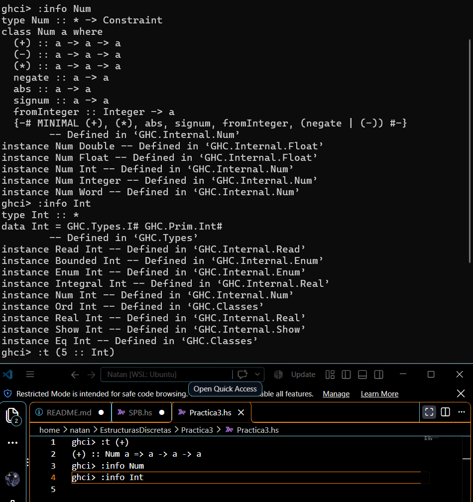

## ¿Cuál es la diferencia entre Num e Int? ##
Num: Es un conjunto que define funciones y operaciones numéricas generales. No es un tipo de dato concreto por sí mismo, sino una categoría a la que pertenecen varios tipos numéricos (como Int, Integer, Float, Double).
Int: Es un tipo de dato específico que representa números enteros con precisión finita. Limitado por el tamaño de palabra de la arquitectura de la máquina, por ejemplo, 64 bits.
